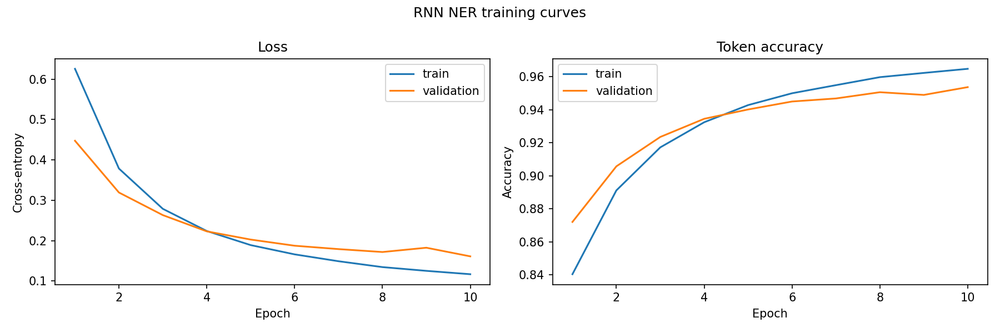
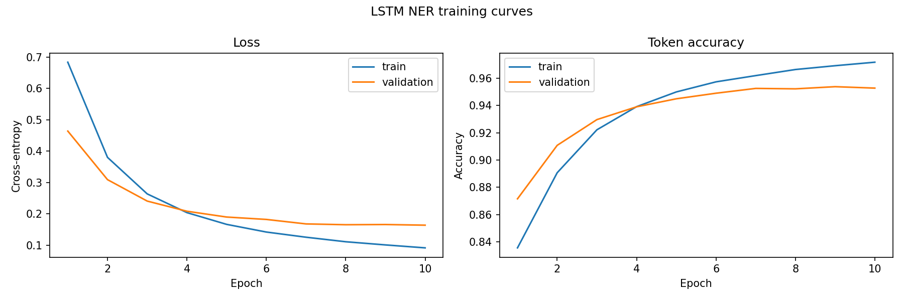
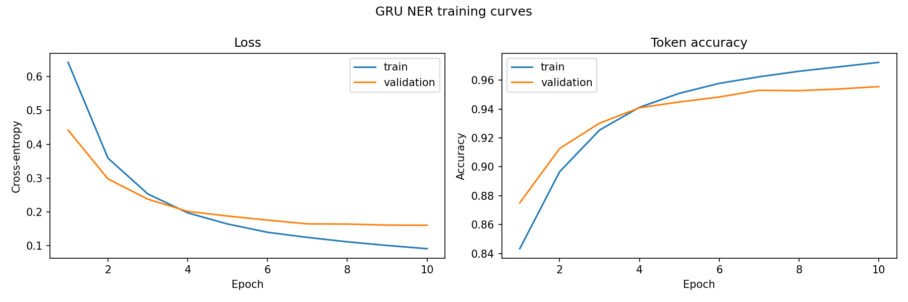

# Named Entity Recognition with Bidirectional RNN, LSTM, and GRU

**A comparative deep learning study of recurrent neural networks for token-level named entity recognition (NER) on the CoNLL-2003 dataset.**

This course project implements three sequence-tagging models—**BiRNN**, **BiLSTM**, and **BiGRU**—using PyTorch. It includes data preparation, a frequency-based word vocabulary, variable-length batching, model training, validation, classification reports, learning curves, and saved model checkpoints.

**Key result:** On the full CoNLL-2003 **validation** split, BiGRU achieved the highest best-epoch token accuracy (**95.56%**) and the highest macro F1 in the saved final-epoch classification reports (**0.83**).

> **Evaluation scope:** All performance figures below come from a recorded full-data training run and refer to the **validation split**, not the held-out test set. Accuracy is computed per token, and the classification reports are token-level (not entity-span-level) evaluations.

## Task and Dataset

Named entity recognition identifies and categorizes named entities in text. This project uses the **CoNLL-2003** English dataset and predicts one of nine BIO-format labels for each token.

| Entity type | Labels | Meaning |
| --- | --- | --- |
| Person | `B-PER`, `I-PER` | Person names |
| Organization | `B-ORG`, `I-ORG` | Organizations |
| Location | `B-LOC`, `I-LOC` | Geographical locations |
| Miscellaneous | `B-MISC`, `I-MISC` | Other named entities |
| Outside | `O` | Token not part of a named entity |

`B-` marks the beginning of an entity and `I-` marks a continuation.

| Dataset split | Sentences |
| --- | ---: |
| Training | 14,041 |
| Validation | 3,250 |
| Test | 3,453 |

The project reads the `tokens` and `ner_tags` columns. Although the dataset also includes part-of-speech and chunking annotations, **these are not used as model input features**. Data is downloaded through Hugging Face Datasets; it is not bundled in this repository.

**Dataset:** [CoNLL-2003 on Hugging Face](https://huggingface.co/datasets/eriktks/conll2003)

## Model Architecture

All three models share the same token-classification pipeline. The recurrent encoder is the only architectural variant:

```text
Tokenized sentence
       |
Word vocabulary / token IDs
       |
Trainable embedding (64 dimensions)
       |
Dropout (0.1)
       |
Bidirectional RNN / LSTM / GRU (64 hidden units per direction)
       |
Dropout (0.1)
       |
Linear projection (128 -> 9)
       |
Per-token NER label predictions
```

For a sentence of length $T$, let $x_t$ be its token ID, and let $E$ denote the learned embedding matrix. The recurrent layer combines the forward and backward contextual representations:

$$
e_t = E[x_t]
$$

$$
h_t = [\overrightarrow{h_t};\overleftarrow{h_t}]
$$

$$
z_t = Wh_t + b
$$

$$
p(y_t = k \mid x_{1:T}) = \frac{e^{z_{t,k}}}{\sum_{j=1}^{K} e^{z_{t,j}}}
$$

Here, $K=9$ is the number of BIO tags. Models are trained with cross-entropy over non-padding tokens:

$$
\mathcal{L} = -\frac{1}{N}\sum_{t\in\mathcal{V}}\log p(y_t^{*}\mid x_{1:T})
$$

where $\mathcal{V}$ contains valid (non-padding) token positions and $N=|\mathcal{V}|$. Padding labels use `-100` and are excluded from the loss and metrics.

**Implementation notes:** Vocabulary tokens are built from the training split only (minimum frequency 5), with `<pad>` and `<unk>` handling. Sentences are dynamically padded within batches, and `pack_padded_sequence` prevents the bidirectional encoders from processing padded time steps as actual tokens. The classifier makes independent per-token predictions; there is **no CRF or BIO-transition-constrained decoder**.

### Model Size

Parameter counts for the full-data vocabulary of 4,917 tokens (all parameters trainable):

| Model | Parameters |
| --- | ---: |
| BiRNN | 332,489 |
| BiLSTM | 382,409 |
| BiGRU | 365,769 |

## Experimental Setup

The recorded full-data run used the following settings:

| Setting | Value |
| --- | --- |
| Embedding dimension | 64 |
| Hidden dimension | 64 per direction |
| Batch size | 32 |
| Epochs | 10 |
| Optimizer | Adam |
| Learning rate | 0.001 |
| Dropout | 0.1 |
| Gradient clipping | 1.0 |
| Vocabulary cutoff | 5 |
| Random seed | 42 |
| Loss | Cross-entropy, ignoring padded labels |
| Recorded execution device | CPU |

For consistency, all three architectures use the same configuration. The training script saves the checkpoint with the **highest validation token accuracy** for each architecture. The classification reports are generated from the **final epoch's in-memory model**; they are not necessarily evaluations of the saved best checkpoint.

## Results

### Model Comparison

These results were extracted from the included full-data notebook execution and the saved classification reports:

| Model | Best validation token accuracy | Final-epoch macro precision | Final-epoch macro recall | Final-epoch macro F1 | Final-epoch weighted F1 |
| --- | ---: | ---: | ---: | ---: | ---: |
| BiRNN | 95.37% | 0.87 | 0.77 | 0.81 | 0.95 |
| BiLSTM | 95.37% | 0.86 | 0.78 | 0.81 | 0.95 |
| **BiGRU** | **95.56%** | **0.88** | **0.78** | **0.83** | **0.95** |

**Note:** The best-epoch accuracy values and final-epoch classification-report values are from different selection criteria. Report values are rounded by scikit-learn to two decimal places. All models were evaluated on **51,362 non-padding validation tokens**.

### Per-Label F1

| NER label | BiRNN | BiLSTM | BiGRU |
| --- | ---: | ---: | ---: |
| `O` | 0.98 | 0.98 | 0.98 |
| `B-PER` | 0.84 | 0.82 | 0.84 |
| `I-PER` | 0.88 | 0.88 | 0.87 |
| `B-ORG` | 0.76 | 0.73 | **0.77** |
| `I-ORG` | 0.75 | 0.73 | **0.77** |
| `B-LOC` | 0.84 | 0.85 | **0.86** |
| `I-LOC` | 0.79 | 0.81 | **0.84** |
| `B-MISC` | 0.80 | 0.81 | 0.81 |
| `I-MISC` | 0.68 | 0.72 | **0.73** |

BiGRU performed best overall in this experiment. All models were especially strong on the frequent `O` class, while the `I-MISC` tag was among the most challenging. Because `O` dominates the dataset, token accuracy alone can obscure performance on entity labels; macro F1 helps provide a complementary view. These results are specific to this configuration and single recorded training run.

### Training Curves

Training and validation loss/accuracy plots are included in the repository:

**BiRNN**



**BiLSTM**



**BiGRU**



Full class-wise precision, recall, F1, and support are available in [`outputs/reports/`](outputs/reports/).

## Getting Started

### 1. Clone the repository

```bash
git clone https://github.com/YOUR_USERNAME/conll2003-recurrent-ner-comparison.git
cd conll2003-recurrent-ner-comparison
```

Replace `YOUR_USERNAME` with your GitHub username and adjust the repository name if you choose a different one.

### 2. Create a Python environment and install dependencies

```bash
python -m venv .venv
source .venv/bin/activate   # Windows: .venv\Scripts\activate
pip install -r requirements.txt
```

Use Python 3.10+ and a compatible PyTorch installation. The code can run on CPU or use CUDA when available. An internet connection is needed on first run to retrieve the dataset.

### 3. Train all three models

For the **full dataset**, reproducing the scope of the reported experiment:

```bash
python scripts/main.py --full-data
```

For the smaller subset specified in `config/config.yaml` (512 train, 128 validation, and 128 test sentences):

```bash
python scripts/main.py
```

Train only one model:

```bash
python scripts/main.py --full-data --model-type gru
```

Other supported values are `rnn`, `lstm`, and `all`. You can edit hyperparameters and output paths in [`config/config.yaml`](config/config.yaml).

**Important:** The default configuration has `use_subset: true`. Run with `--full-data` to match the dataset scope of the results presented above; subset-mode results will not be comparable.

### 4. Inspect outputs

Each run produces:

- `models/saved_models/{rnn,lstm,gru}_ner.pt` — best-validation-accuracy checkpoint for each trained model, including its vocabulary, label names, and configuration.
- `outputs/plots/{rnn,lstm,gru}_curves.png` — training and validation curves.
- `outputs/reports/{rnn,lstm,gru}_classification_report.txt` — final-epoch validation classification reports.

For the original full-data notebook workflow, see [`notebooks/hw4-q1-deeplearning.ipynb`](notebooks/hw4-q1-deeplearning.ipynb). **The notebook was executed in Kaggle and includes environment-specific paths and a GitHub clone URL**; the CLI above is the recommended way to run the project locally.

## Repository Structure

```text
.
├── config/
│   ├── config.yaml              # Dataset, model, training, and output settings
│   └── logging.yaml
├── data/
│   └── data_loader.py           # Dataset loading, vocabulary, and padded batches
├── models/
│   ├── model.py                 # Shared bidirectional sequence tagger
│   └── saved_models/            # Saved model checkpoints
├── notebooks/
│   └── hw4-q1-deeplearning.ipynb
├── outputs/
│   ├── plots/                   # Loss and accuracy curves
│   └── reports/                 # Per-token classification reports
├── scripts/
│   ├── main.py                  # Experiment entry point
│   ├── train.py                 # Training loop
│   └── evaluate.py              # Validation evaluation
├── utils/
│   ├── metrics.py
│   └── visualization.py
├── requirements.txt
└── README.md
```

## Limitations and Possible Extensions

- **No test-set metrics reported:** The pipeline creates a test loader, but the experiment's printed reports and learning curves use validation data.
- **Token-level rather than entity-level evaluation:** Exact-match entity-span F1 (commonly used in NER benchmarks) is not computed here.
- **Single run:** The results do not include multiple random seeds or confidence intervals.
- **Static word embeddings and vocabulary cutoff:** Rare or unseen words can map to `<unk>`; pretrained or subword embeddings might improve generalization.
- **No structured decoder:** A CRF layer or constrained BIO decoding could be explored to enforce valid label transitions.

## Technologies

Python · PyTorch · Hugging Face Datasets · scikit-learn · NumPy · Matplotlib · PyYAML

## Acknowledgments

Developed as a deep learning course project using the CoNLL-2003 NER benchmark. For dataset background, see the [CoNLL-2003 shared task paper](https://aclanthology.org/W03-0419/) and the [Hugging Face dataset repository](https://huggingface.co/datasets/eriktks/conll2003).
